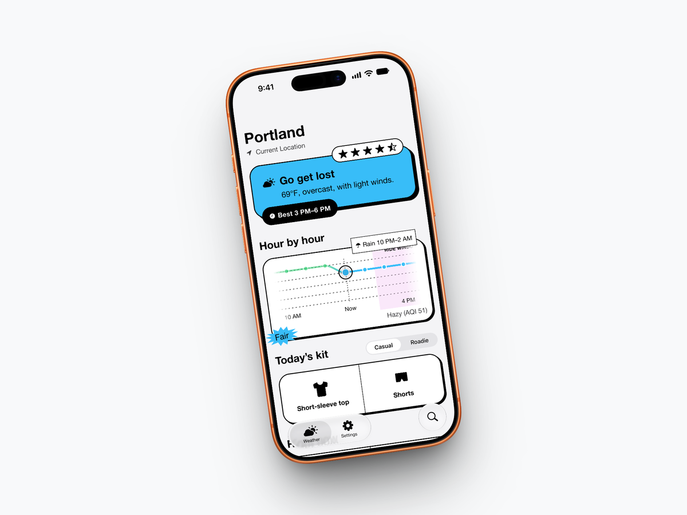
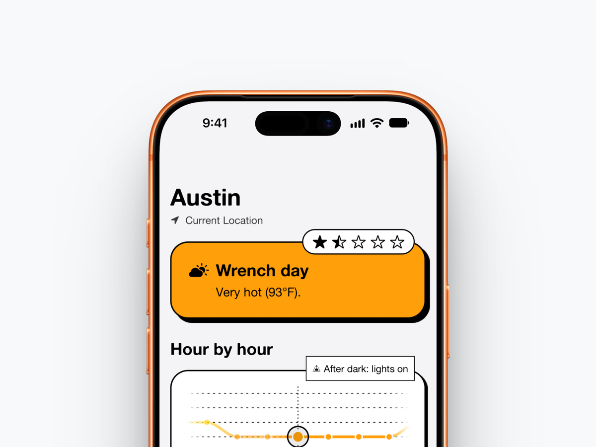
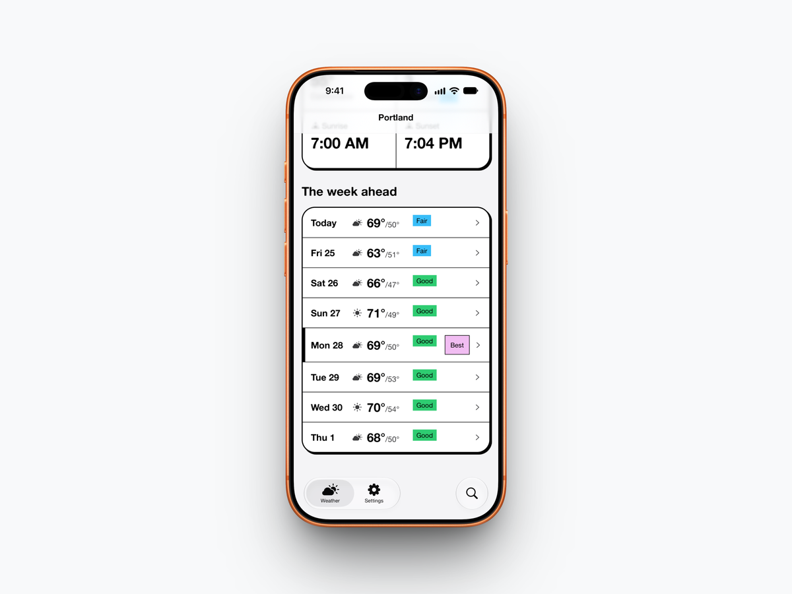
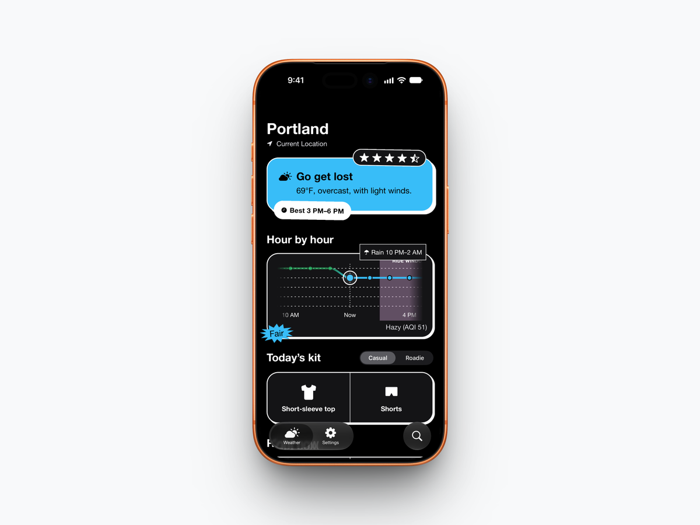

# Wheely Weather

[](https://opensource.org/licenses/MIT)
[](https://github.com/noahzm/wheely-weather/actions)
[](https://expo.dev/)

A cyclist-first weather app for iOS, Android, and the web. Live at [wheelyweather.app](https://wheelyweather.app).

<a href="https://apps.apple.com/app/id6788117343">
  <picture>
    <source media="(prefers-color-scheme: dark)" srcset="./public/app-store-badge-white.svg" />
    
  </picture>
</a>

<p>
  
  
</p>
<p>
  
  
</p>

## Features

- **Ride verdict**: a 0–5 star score and a go / maybe / skip call from temperature, wind and gusts, rain, dew point, AQI, UV, and daylight
- **Hourly and 8-day ratings**: every hour and day rated Good to Bad, with a one-line reason and the week's best ride day
- **Kit picks**: what to wear, for Casual or Roadie riders
- **Home climate**: comfort limits shift if your home runs hot, humid, or cold, more so the more often you ride outdoors
- **Locations**: search, pinned places, and a current-location mode that follows you
- **Alerts**: severe weather and air quality warnings
- **Home Screen widget** (iOS): the verdict plus the next 12 hours, refreshed in the background

## Tech stack

|                 | iOS              | Web                                                           | Android                     |
| --------------- | ---------------- | ------------------------------------------------------------- | --------------------------- |
| **Weather**     | Apple WeatherKit | WeatherKit via a Cloudflare Worker (Open-Meteo fallback)      | Open-Meteo                  |
| **Search**      | Apple MapKit     | Nominatim via the Worker                                      | Nominatim                   |
| **Alerts**      | WeatherKit       | WeatherKit via the Worker (National Weather Service fallback) | US National Weather Service |
| **Air quality** | Open-Meteo       | Open-Meteo                                                    | Open-Meteo                  |

Built with Expo SDK 58, Expo Router, React Native 0.88, and React 19 (React Compiler on). Hosted on Cloudflare, errors reported to Sentry.

## Getting started

Requires Node 24+. iOS needs Xcode, since WeatherKit and MapKit don't run in Expo Go.

```bash
npm install
cp .env.example .env   # optional: Sentry DSN
npm run web            # or: npm run ios / npm run android
```

## Commands

| Command                 | What it does                                                  |
| ----------------------- | ------------------------------------------------------------- |
| `npm run check`         | Everything CI runs: format, lint, types, tests, build         |
| `npm test`              | Unit tests                                                    |
| `npm run test:coverage` | Unit tests with coverage floors                               |
| `npm run e2e:ios`       | iOS end-to-end flows (Maestro, needs the simulator and Metro) |
| `npm run ios:clean`     | Regenerate the native iOS project and run                     |

## Project structure

```
src/
├── app/         # Screens (Expo Router)
├── components/  # UI
├── domain/      # Scoring, acclimatization, gear logic
├── hooks/       # Forecast, location, and theme state
├── services/    # Weather and geocoding, per platform
└── utils/       # Formatters and chart math
modules/         # Native iOS modules (WeatherKit, MapKit)
targets/         # iOS Home Screen widget (SwiftUI)
workers/         # Cloudflare Worker (forecast and geocoding API)
```

## Deployment

- **Web**: every push to `main` deploys to Cloudflare.
- **iOS**: built and submitted with EAS (`npm run eas:build:ios-prod`).

## More

[`AGENTS.md`](./AGENTS.md) (architecture and conventions) · [`CONTRIBUTING.md`](./CONTRIBUTING.md) · [`SECURITY.md`](./SECURITY.md) · [MIT License](./LICENSE)
